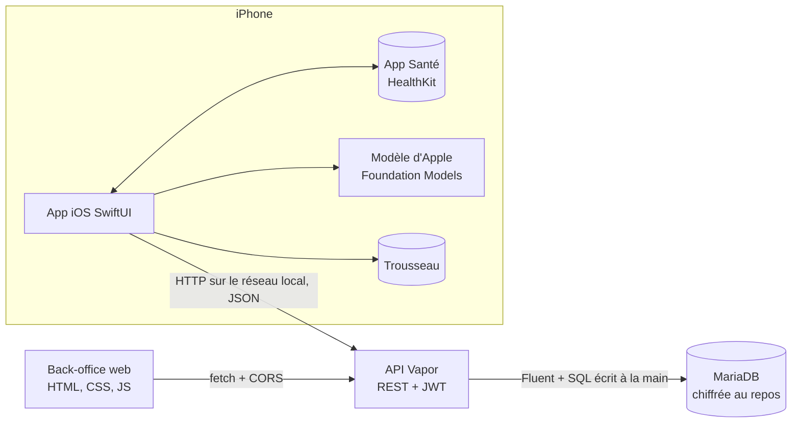
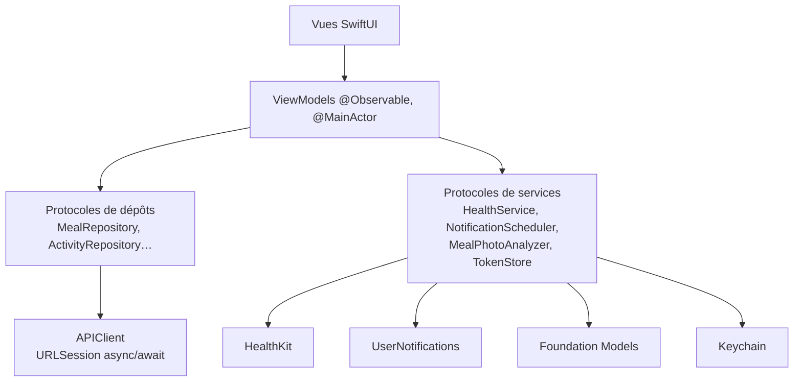
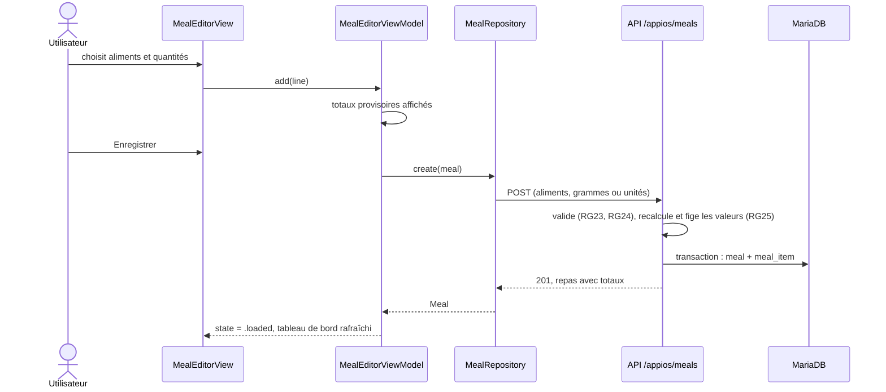

# ZakFit — architecture

Version 1 du 27/11/2026.

L'architecture suit deux références :
- les conventions de l'API LineUp, projet précédent de la formation (Vapor 4, Fluent, MariaDB, JWT) ;
- sept principes d'architecture iOS retenus pour ce projet : SOLID, injection de dépendances, programmation par protocoles, états impossibles non représentables, immutabilité, *fail fast* et testabilité. Ils s'appliquent aussi à l'API (§2.6).

Le modèle de données est décrit dans `04-mcd-mld-mpd.md`, le diagramme de classes dans `diagrammes/modelisation.drawio` (page UML - D.Classes), et le contrat d'API dans `05-contrat-api.md` et `api/openapi.yaml`.

## 1. Vue d'ensemble



- **La base du serveur fait foi.** L'app ne garde que le jeton, dans le Trousseau, sans cache de données. L'app ne fonctionne pas hors ligne.
- **Les photos du bonus ne quittent jamais l'iPhone.** L'analyse se fait sur l'appareil, et seuls les aliments validés partent à l'API (RG28).
- **Ce qui vient de Santé** passe par l'API, qui le copie sans doublon (RG33), avec le consentement (RG10).

## 2. API Vapor

### 2.1 Dossiers, sur le modèle de LineUp

```
backend/Sources/ZakFitAPI/
├── configure.swift      base (variables d'environnement), migrations, middlewares, CORS, Swagger
├── routes.swift         enregistrement des controllers
├── Controllers/         un RouteCollection par ressource
├── DTOs/<Ressource>DTOs Create…DTO, Update…DTO, …ResponseDTO, …QueryDTO
├── Models/              modèles Fluent, un par table ; Models/Enums pour les listes de valeurs
├── Migrations/          une migration par table, dans l'ordre du script MPD
├── Middleware/          JWTMiddleware, AccountStatusMiddleware, AdminMiddleware
├── Errors/              un enum par ressource, conforme à AbortError
├── Services/            calculs et règles réutilisés par plusieurs controllers
├── Repositories/        requêtes SQL écrites à la main (statistiques)
└── JWT/                 UserPayload
```

### 2.2 Conventions

| Sujet | Règle | Origine |
|---|---|---|
| Routes | `/auth/...` publiques, `/appios/...` avec jeton, `/backoffice/...` avec jeton et rôle admin | LineUp |
| Ordre dans un controller | `boot`, fonctions transversales, fonctions appios seules, fonctions backoffice seules, helpers `private` en fin de fichier | Méthode de Slimane, LineUp |
| Erreurs | `throw MealsError.notFound`, jamais `Abort(...)` en dur ; 404 pour la ressource d'un autre (RG09), 409 pour un conflit d'état | Fiche de cours « Gestion des erreurs », LineUp |
| Écritures multiples | `req.db.transaction` (repas et lignes, retrait du consentement, suppression de compte) | LineUp |
| Listes | `paginate(for:)`, réponse `items` + `metadata`, 10 par page, 100 au plus (`app.fluent.pagination.pageSizeLimit = 100`, sinon Fluent accepte n'importe quelle taille) | LineUp, contrat |
| Données exposées | Toujours un DTO de réponse, jamais le modèle Fluent. `password_hash` ne sort jamais (RG03) | RG03, RG45 |
| Secrets | `.env` hors dépôt, `.env.example` sans valeur ; la clé JWT vient de l'environnement | Contrôle des secrets de LineUp |

### 2.3 Chaîne de middlewares d'une requête protégée

1. **CORS**, placé **avant** l'ErrorMiddleware, pour que les réponses d'erreur gardent leurs en-têtes. C'est un piège rencontré sur LineUp. Seule l'origine du back-office est autorisée.
2. **ErrorMiddleware** : transforme les erreurs `AbortError` en `{ "error": true, "reason": "..." }`.
3. **JWTMiddleware** (`AsyncMiddleware`, paquet `vapor/jwt` en version 4, comme LineUp) : vérifie la signature et l'expiration (7 jours) et renvoie 401 si le jeton est absent, invalide ou expiré (RG05). Le jeton ne porte que l'identifiant de l'utilisateur.
4. **AccountStatusMiddleware**, sur toutes les routes protégées, `/backoffice` compris : relit le compte en base, renvoie 403 s'il est bloqué ou suspendu, et lève tout seul un blocage dont la date de fin est passée (RG06). Il range le compte relu dans la requête (`req.auth.login(user)`).
5. **AdminMiddleware**, seulement sur `/backoffice` : renvoie 403 si le compte **relu en base** n'est pas administrateur (RG44). Contrairement au `StaffMiddleware` de LineUp, il ne lit jamais le rôle dans le jeton (RG05) : un rôle retiré prend effet tout de suite.

Les routes `/auth` passent en plus par un **limiteur de débit**, Gatekeeper, comme dans LineUp. Il freine les essais de mots de passe en série sur `/auth/login`.

### 2.4 Services, un rôle chacun (principe de responsabilité unique)

| Service | Rôle | Règles |
|---|---|---|
| `EnergyCalculator` | Dépense de repos (Mifflin-St Jeor), niveau d'activité, objectif calculé, plancher et plafond, kcal d'une séance en MET net, suggestion d'activité | 02-formules §1-3, §6, §8 ; RG31, RG34, RG41 |
| `NutritionCalculator` | Valeurs figées d'une ligne, totaux d'un repas et d'un jour, contrôle RG18, macros proposées en grammes | RG18, RG24-RG26, RG36 |
| `CompatibilityService` | Compatibilité d'un aliment avec les régimes et les allergènes d'un utilisateur | RG16, RG17, RG21 |
| `GoalService` | Version de l'objectif à chaque changement, objectif d'un jour passé, versions des objectifs d'activité | RG37, RG52 |
| `ConsentService` | Donner ou retirer le consentement, et effacer ce que RG11 efface, en une transaction | RG10, RG11 |
| `AccountDeletionService` | Supprimer les repas, puis les favoris, puis le compte, en une transaction | RG43 |
| `HealthImportService` | Import en lot de séances, de pesées et d'énergie active, sans doublon, avec la table de correspondance des types | RG33, RG39, RG40 |
| `StatsRepository` | Requêtes SQL écrites à la main (SQLKit) pour l'historique, les rapports et le tableau de bord d'administration, avec masquage des groupes de moins de 5 | RG47, p. 25-26 du cahier |

Les controllers restent fins : ils décodent le DTO, valident (`Validatable`), appellent un service, puis renvoient un DTO.

### 2.5 Tests

- **VaporTesting et Swift Testing**, comme LineUp (`@Suite(.serialized)`), sur une base de test séparée (`TEST_DATABASE_NAME`), parce que les tests annulent leurs migrations. C'est un piège de LineUp.
- **À tester :** les formules, sur les exemples de `02-formules.md` ; chaque règle de sécurité (sans jeton, jeton expiré, compte bloqué, ressource d'un autre, non-admin) ; les filtres et les tris ; le retrait du consentement et la suppression de compte.
- **Les contraintes de la base** sont déjà vérifiées par `modele/tester_sql.py`, avec 47 cas interdits.

### 2.6 Migrations, injection, horloge et jours locaux

**Les migrations recréent tout le MPD.** Le constructeur de schéma de Fluent ne sait créer ni les contraintes CHECK, ni les colonnes générées PERSISTENT (`active_flag`, `category_key`, `current_flag`), ni les clés étrangères composées (`fk_meal_item_portion_food`), ni des précisions DECIMAL fines.
- Chaque migration crée sa table avec Fluent (colonnes, clés, UNIQUE), puis ajoute ces éléments par du SQL écrit à la main (`(database as! any SQLDatabase).raw(...)`), repris de `sql/01-schema.sql`.
- **Critère d'acceptation :** sur une base créée par les migrations, `modele/tester_sql.py` donne le même résultat que sur une base créée par le script, soit 47 refus.
- Les référentiels (`sql/02-referentiels.sql`) se chargent par une migration de données, les données de démo par une commande séparée.

**Injection côté API.** Les services sont des protocoles (par exemple `EnergyCalculating`). L'implémentation réelle est rangée dans `Application.storage` au démarrage, puis exposée par une extension de `Request` (`req.energy`). Les tests remplacent l'implémentation par un faux.

**Une horloge injectée.** Plusieurs règles dépendent de l'instant présent :
- la fin d'un blocage (RG06) ;
- les 18 ans (RG12) ;
- l'absence de date future (RG23, RG30) ;
- l'alerte de 18 h (RG41) ;
- la date d'effet d'une version d'objectif (RG52).

Elles lisent toutes `now()` dans un protocole `Clock` (`SystemClock` en production, `FixedClock` dans les tests), jamais `Date()` directement. Même principe dans l'app iOS.

**Jours locaux.** Les colonnes `DATE` (`eaten_on`, `performed_on`, `weighed_on`, `day`, `valid_from`, `valid_to`, `effective_from`) sont des jours, pas des instants.
- Côté Swift, API comme app, elles sont typées par une valeur `LocalDate` (année, mois, jour), encodée en `"AAAA-MM-JJ"` et jamais convertie en `Date`.
- Le passage d'un instant à un jour se fait à un seul endroit, avec le fuseau de l'utilisateur. Par exemple, pour `performed_on` : `LocalDate(instant, in: TimeZone(identifier: user.timeZone))`.
- Ainsi, aucun décalage d'un jour n'est possible au passage de minuit (RG38).

## 3. App iOS

### 3.1 Couches



```
ios/ZakFit/
├── App/             ZakFitApp, AppEnvironment (racine de composition : crée et injecte les dépendances)
├── Features/        un dossier par écran : Auth, Onboarding, Dashboard, Meals, Activities, Goals, History, Settings, PhotoMeal
│   └── Meals/       MealsView, MealsViewModel, MealEditorView, MealEditorViewModel…
├── Domain/          modèles en valeurs (struct), enums de domaine, erreurs typées
├── Data/            APIClient, DTO, implémentations des dépôts
├── Services/        HealthKitService, LocalNotificationScheduler, FoundationModelsMealAnalyzer, KeychainTokenStore
├── DesignSystem/    couleurs, typographie, espacements et composants tirés du Figma
└── Resources/       Localizable.xcstrings (français, anglais)
```

### 3.2 Les principes de la capture, appliqués

| Principe | Dans ZakFit |
|---|---|
| **Responsabilité unique (SOLID)** | Une vue affiche, un ViewModel prépare l'état de l'écran, un dépôt parle à l'API, un service parle à un framework d'Apple. Pas de calcul nutritionnel dans les vues. |
| **Ouvert-fermé, substitution** | Les ViewModels dépendent de protocoles. Remplacer `FoundationModelsMealAnalyzer` par une autre analyse ne touche pas l'écran. |
| **Injection de dépendances** | Les dépendances passent par l'initialiseur ou par `AppEnvironment`, l'unique racine de composition. Aucun singleton caché (`shared`) dans les ViewModels. |
| **Programmation par protocoles** | `MealRepository`, `HealthService`, `MealPhotoAnalyzer`, `TokenStore`, `NotificationScheduler`. Chacun a son implémentation réelle et un faux pour les tests et les aperçus SwiftUI. |
| **États impossibles non représentables** | `enum LoadState<Value> { case idle, loading, loaded(Value), failed(AppError) }` remplace un trio `isLoading`, `data?`, `error?` incohérent. Même idée pour l'objectif calorique (`case computed / manual(kcal:)`), le consentement et l'état des kcal d'une séance (`entered`, `estimated`, `unknown`). Le principe vaut aussi pour les DTO, des deux côtés : la quantité d'une ligne se décode en `enum Quantity { case grams(Decimal), portions(id: UUID, count: Decimal) }`, et l'objectif calorique en `enum CalorieGoalInput { case computed, manual(kcal: Int) }`, plutôt qu'en champs facultatifs qui pourraient se contredire. |
| **Immutabilité** | Les modèles du domaine et les DTO sont des `struct` en `let`. Un ViewModel publie un nouvel état au lieu de modifier des objets partagés. |
| **Fail fast** | Validation à la saisie (formulaires), puis validation de l'API. Erreurs typées (`AppError` : `network`, `unauthorized`, `forbidden`, `notFound`, `conflict(reason:)`, `validation(reason:)`) affichées clairement ; un jeton expiré renvoie à la connexion. |
| **Testabilité** | Swift Testing sur les ViewModels avec des faux dépôts, et un test d'interface du parcours principal (inscription, repas, tableau de bord). |

### 3.3 Points techniques

- **Swift 6, concurrence stricte.** Les ViewModels sont `@MainActor @Observable`. Les dépôts et les services sont `Sendable`. Les appels réseau se font en `async/await`.
- **Jeton :** dans le Trousseau, jamais dans UserDefaults, plus exposé (le cahier dit « stockage local », p. 6). La déconnexion efface le jeton (RG08).
- **Réseau local :** l'API tourne en HTTP sur le Mac (pas de HTTPS, voir 01 §5). L'app déclare `NSLocalNetworkUsageDescription` et l'exception ATS `NSAllowsLocalNetworking`, limitée au réseau local, sans rien autoriser d'autre.
- **Back-office web :** le jeton est gardé en `sessionStorage`, et effacé à la fermeture de l'onglet. Les données sont insérées avec `textContent`, jamais `innerHTML`, contre l'injection de script (XSS).
- **Santé :** l'autorisation est demandée type par type. ZakFit lit les séances, l'énergie active et le poids, et écrit les séances saisies et les pesées. Il ignore ce qu'il a écrit lui-même (RG33).
- **Notifications locales :** reprogrammées après chaque saisie, d'après les données de l'API (RG42).
- **Bonus photo :** `MealPhotoAnalyzer` n'existe que si iOS 27 et Apple Intelligence sont disponibles (`#available` et contrôle de disponibilité du modèle). Sinon, le bouton n'apparaît pas (RG28).
- **Langues :** catalogue `Localizable.xcstrings` en français et en anglais. Le nom d'un aliment est pris dans la langue de l'appareil (RG49).
- **iPad :** mise en page adaptative, sans écran dédié.

## 4. Exemple de parcours : ajouter un repas



L'app affiche des totaux provisoires pendant la saisie, mais seules les valeurs calculées par l'API sont enregistrées (RG24). Les deux calculs utilisent les mêmes formules (`02-formules.md` §5).
